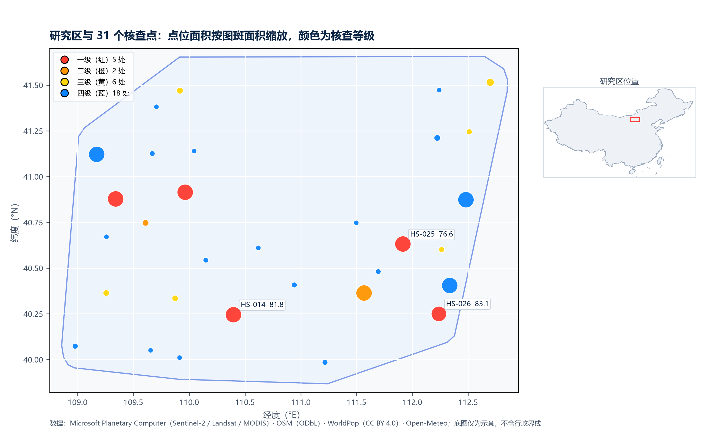
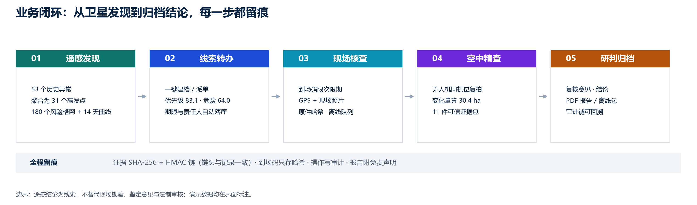
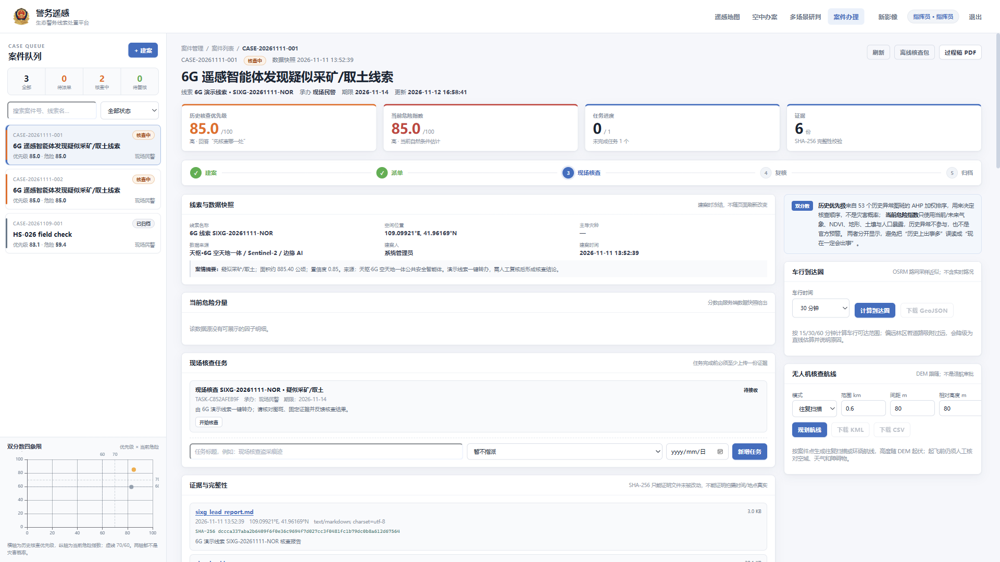
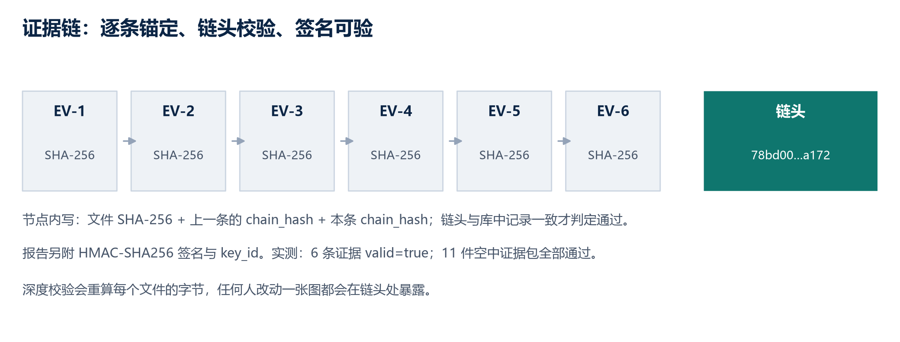
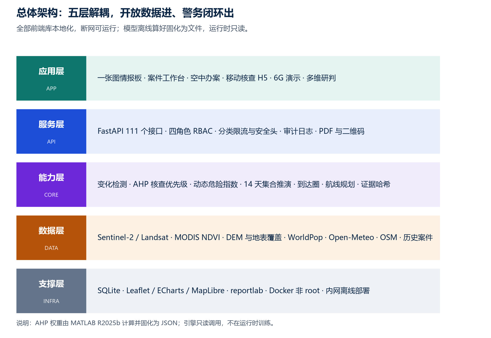
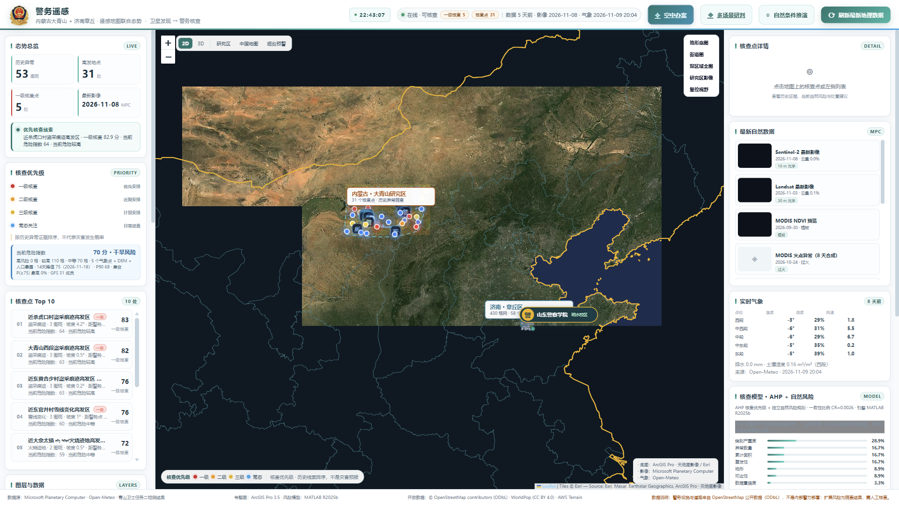
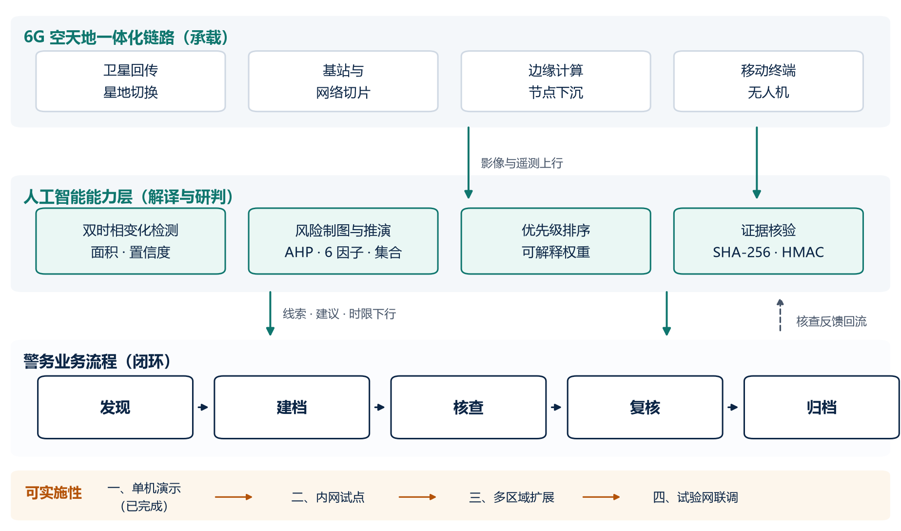
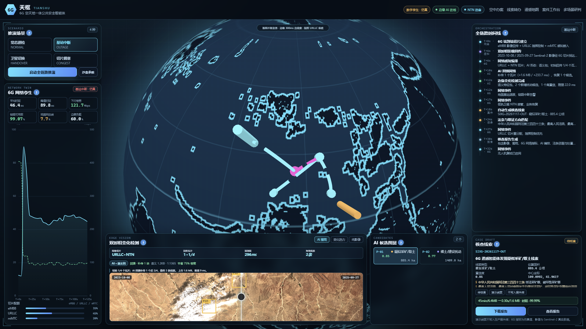
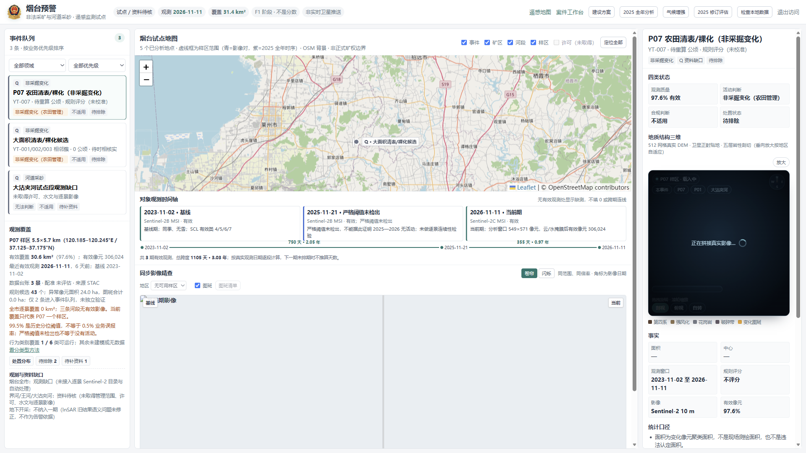

> 技术文档源（Markdown）。`docs/` 下的 docx/pdf 为并行生成版本，页数与本文排版口径不同；本文保留完整表格与图注，便于评委核对。

# 警务遥感·生态安全与灾害风险一张图

## 传智杯 Vibe Coding 技术文档

- 参赛赛道：2026 第九届传智杯 · AI 创新应用挑战赛（Vibe Coding，个人赛）
- 作品形态：单机可启动的 Web 应用（FastAPI + 原生 HTML/CSS/JS + SQLite）
- AI 协作工具：ZCode；模型 new-provider/deepseek-v4.1-flash（variant max）
- 文档版本：v1.0；日期：2026-11-17
- 代码位置：vibe_repo（本文与图表位于 docs/）
- 公网演示：https://laptop-la55o0s1.tailcda52b.ts.net
- 复现要求：Python 3.10+；无需 Node、无需构建、无需数据库服务、无需云 API Key

## 目录

- 1 作品概述与真实痛点
- 2 用户、流程与业务闭环
- 3 系统架构
- 4 AI 协作方法与意图控制
- 5 三条主链：从 Prompt 到可复现改动
- 6 可复现性
- 7 工程质量与架构取舍
- 8 Git 历史：如实说明与重建规则
- 9 验证、未验证项与合规边界
- 10 部署与运行
- 11 附录

## 1 作品概述与真实痛点

### 1.1 一句话定位

本作品把“卫星看见地表变化”接到“警务可核查、取证、复核、归档”的链路上。输入是公开卫星影像与地理数据，输出不是专题图，而是一条带优先级、证据、法条提示与审计记录的案件线索。

系统由一张图、烟台专项工作区、6G 空天地推演、空中办案、案件工作台、移动核查端六个页面组成，共用一套 FastAPI 服务、一套案件存储和一套角色权限。全部功能可在一台普通笔记本上离线启动，不依赖 Node、构建链、数据库服务或任何云 API Key。

“一张图”负责发现与排序：31 个核查点、180 个风险格网、14 天风险推演、灾害目录、历史图斑。“烟台”负责单点深挖：双时相影像、候选图斑、时长对比、地点变化、3D 地质面板。“6G”负责把网络状态与影像推理绑在一起：网络差时少传瓦片、只传有线索的区域。“工作台”负责把线索变成案件：建案、派单、现场核查、复核、归档。“移动端”负责现场数据入口：到场码、GPS、拍照、离线队列。

### 1.2 基层的真实断点

本作品针对遥感结果落地时反复出现的五个断点。

- 发现断点：遥感平台给出图斑，但图斑停在图层里。哪个点该先去、为什么先去，没有可解释的排序，最后仍靠经验挑。
- 流转断点：图斑转案件靠电话、微信和纸质单。线索编号、分数口径、责任人在流转中丢失，现场看到的和屏幕上看到的不是一回事。
- 取证断点：照片散落在个人手机里，没有拍摄时间、坐标、哈希的绑定。事后无法证明“这张照片就是那次核查、没有被改过”。
- 复核断点：变化检测结果被直接当成结论。缺少“确认／排除／存疑”的结构化意见，也缺少对评分口径的说明。
- 归档断点：报告靠手工拼接，法条靠个人记忆，审计链缺失。案件办完之后，过程不可回放。

表 1-1 把断点、后果和本作品的补法放在一起。

| 断点 | 现场表现 | 直接后果 | 本作品的补法 |
|---|---|---|---|
| 发现 | 图斑无排序、无责任人 | 高价值点被淹没 | AHP 八因子评分 + 危险等级 + 优先级双分数 |
| 流转 | 线索靠口头传递 | 编号与口径丢失 | 一键建案，服务端冻结分数快照，生成案件号 |
| 取证 | 照片在个人手机 | 无法证明未篡改 | 上传即算 SHA-256，案件级 HMAC 链，深度校验 |
| 复核 | 变化即结论 | 误判进入处置 | 观测事实／活动迹象／合规状态／处置建议四分栏 |
| 归档 | 手工拼报告 | 过程不可回放 | PDF 报告 + 离线包 + 审计日志 + 证据链头 |

### 1.3 作品做了什么

表 1-2 按能力列出实现要点、可核对位置和明确边界。表中不写“效果好”，只写能复跑的结果。

| 能力 | 实现要点 | 可核对位置 | 明确边界 |
|---|---|---|---|
| 遥感发现 | Sentinel-2 双时相，BSI/NDVI 指数，分位数阈值，3×3 形态学，最小图斑 | app/yantai_api.py；data/yantai_rs/catalog.json | 规则算法，非训练模型；无真值，未做精度评估 |
| 一张图 | 31 核查点、180 格网、14 天推演、灾害目录 | /、/api/hotspots、/api/risk-grid | 研究区为大青山，非全国 |
| 6G 推演 | 四场景、网络感知编排、边缘规则推理、语义回传 | app/sixg_api.py；/sixg | 全部为仿真指标，不是现网实测 |
| 案件闭环 | 四角色、五步流转、到场码、离线队列 | app/case_store.py；app/case_api.py | 演示数据，不接真实警务系统 |
| 证据链 | 逐份 SHA-256，案件级 HMAC-SHA256 链 | app/case_store.py:888-915 | 不是法定电子签章 |
| 法条辅助 | 17 条草稿，同义词、双字相似度、语义规则 | app/legal.py；data/legal/knowledge_base.json | 检索推荐，不构成法律意见 |
| 移动核查 | 签到、拍照、IndexedDB 队列、恢复同步 | /m；web/mobile.js | 浏览器能力受限，离线为单机队列 |

### 1.4 与评分维度的对应

文档结构与评分权重一一对应。权重来自赛题说明，表 1-3 只做定位，不重复论证。

| 评分维度 | 权重 | 对应章节 | 主要证据 |
|---|---:|---|---|
| 问题定义与真实价值 | 25% | 第 1、2 章 | 五个断点、四角色、五步流转、边界声明 |
| 产品完成度与体验 | 25% | 第 2、3、10 章 | 六个页面、111 个接口、移动端、离线队列 |
| AI 协作与意图控制 | 20% | 第 4、8 章 | 五条工作协议、返工复盘、会话锚点 |
| 工程质量与可复现 | 15% | 第 6、7 章 | 一键启动、健康检查、代码规模、取舍记录 |
| 表达与合规 | 15% | 第 9、10、11 章 | 验证清单、未验证项、数据来源、部署说明 |

### 1.5 阅读约定

本文的数字只有三个来源：仓库文件、接口实际返回、会话导出。凡是“设计目标”而非“实测结果”，文中会直接写明。所有未能验证的事项集中在第 9 章，不在正文里用模糊表述掩盖。

文中“AI”指协作工具 ZCode，不指系统内的算法。系统内没有大语言模型，也没有训练型深度学习模型；影像侧是指数计算、阈值、形态学与连通域，法条侧是字符串归一化、双字相似度与人工规则。这一点在第 5、7、9 章反复出现，因为它是本作品与“接一个模型 API”的根本区别。



## 2 用户、流程与业务闭环

### 2.1 四类角色

系统只有四类角色，权限按“最小必要”切分。角色不是装饰，每个角色都对应一个不可替代的动作：指挥员决定办不办、民警证明到过现场、复核员决定采不采信、管理员维护账号与审计。

| 角色 | 演示账号 | 可以做什么 | 不能做什么 |
|---|---|---|---|
| 指挥员 commander | Commander@12345 | 建案、派单、归档、查看全量统计 | 不代替民警上传现场证据 |
| 现场民警 officer | Officer@12345 | 接任务、签到、拍照、提交证据、补充说明 | 不能复核自己提交的证据 |
| 复核员 reviewer | Reviewer@12345 | 逐份查看证据、给出确认／排除／存疑意见 | 不能修改已上传证据的哈希 |
| 管理员 admin | Admin@12345 | 账号管理、审计查看、系统配置 | 默认不参与具体案件研判 |

权限在服务端校验，前端隐藏按钮只是体验优化。涉及研判结论写入的接口只允许 admin、commander、reviewer，officer 调用会被拒绝；这一点在烟台工作区与案件复核两处都做了同样的限制。

### 2.2 案件五步流转

工作台内部的案件状态是五步：建案、派单、现场核查、复核、归档。状态字段的取值是“待派单、核查中、待复核、已复核、已归档”：建案后进入待派单，派单后进入核查中；界面把建案与派单拆成两个可见步骤。每一步都有明确的进入条件与留痕，不允许跳步。

| 步骤 | 触发动作 | 系统动作 | 责任角色 | 留痕 |
|---|---|---|---|---|
| 1 建案 | 线索卡“建案” | 生成案件号，冻结服务端分数快照 | 指挥员 | 案件记录、分数快照、操作人 |
| 2 派单 | 选择民警与时限 | 生成任务与到场码，推送移动端 | 指挥员 | 任务记录、到场码、时限 |
| 3 现场核查 | 民警到场签到、拍照 | 校验到场码与坐标，接收证据并计算哈希 | 民警 | 签到时间、GPS、照片、哈希 |
| 4 复核 | 复核员逐份查看 | 记录确认／排除／存疑与理由 | 复核员 | 复核意见、时间、操作人 |
| 5 归档 | 指挥员确认 | 生成 PDF、离线包，写入链头 | 指挥员 | 报告、清单、审计、链头 |

两个硬约束贯穿全程。第一，任务完成前必须至少有一份证据，空手不能结案。第二，分数只在建案时由服务端计算并冻结，之后前端展示的是快照，不允许现场改分。这两条是为了避免“先定结论再补材料”。

### 2.3 端到端五段与工作台的关系

端到端视角比工作台多两段：前面的“遥感发现”，中间的“空中精查”。图 2-1 是完整链路，工作台的五步是其中第 2 至第 5 段的具体实现。



需要区分两个“五”。图 2-1 的五段是业务视角，包含遥感发现与空中精查；2.2 节的五步是工作台状态机，从建案开始。两者不是同一层概念，文中不会混用：说“五段”时指图 2-1，说“五步”时指案件状态。

遥感发现段的输入是 53 条历史异常记录，聚合为 31 个高发点；180 个 0.2 度格网承载当前风险与 14 天推演；灾害目录提供灾种与法条映射。线索转办段把图斑变成案件，分数快照在这一步冻结。现场核查段由移动端完成。空中精查段用同机位复拍补细节，30.4 公顷、11 件证据是一次演示的实测汇总。研判归档段输出复核意见、PDF、离线包与审计记录。

### 2.4 现场端：把“到场”变成可验证数据

移动端不追求功能多，只解决三个问题：人到了没有、位置对不对、数据传没传上去。

到场码是一次性令牌，绑定案件、民警与有效期。民警打开 `/m#t=...` 后，页面校验令牌，再读取浏览器定位。系统同时记录签到时间、经纬度、精度半径与目标点距离；精度不足或距离超出阈值时，提交会带上标记，复核端能看到，而不是被静默丢弃。

拍照后先进入本地队列，再按顺序上传。队列放在 IndexedDB，断网时保留，恢复后自动重试；每条记录带客户端生成的 id，服务端按 id 幂等，重复提交不会产生两份证据。上传成功后服务端计算 SHA-256，写入证据表并挂到案件链上。页面明确提示“离线期间数据只在本机”，不把浏览器存储说成安全存储。



### 2.5 证据链：能证明什么，不能证明什么

证据链的设计目标只有一个：证明某份证据在登记之后没有被改动，并且改动的先后顺序可回放。它不证明证据内容真实，也不替代法定电子签章。

实现分三层。第一层，每份证据上传时计算 SHA-256，作为文件指纹。第二层，每条证据记录写入前一条的 chain_hash、本条文件哈希、时间戳、操作人，再用案件级密钥做 HMAC-SHA256，得到本条 chain_hash。第三层，案件归档时把最后一条 chain_hash 写入链头表 case_chains，作为该案件的封存点。

```text
node_hash = HMAC-SHA256(key, prev_hash + file_sha256 + evidence_id + uploaded_at)
```

校验分两种。快速校验逐条重算 HMAC，检查链路是否连续；深度校验会重新读取文件字节、重算 SHA-256，再重算整条链。实测 6 条证据全部 valid=true，11 件空中证据包全部通过；手动改动一个字节后，对应节点与后续节点全部失败，链头不再匹配。



边界必须写清楚：哈希只能证明“登记后未改动”，不能证明“拍摄时未被篡改”；HMAC 密钥存放在本机 instance 目录，演示环境与生产环境的密钥管理不是一回事。文档与页面都不把这条链称为“司法级存证”。

### 2.6 法条辅助与数据底座

法条库共 17 条，全部标记为 draft_requires_legal_review。系统做的是“根据关键字给出可能适用的主要法条与候选条目”，不是法律适用结论。灾种与法条的映射由人工维护，命中结果附带原因与分数，便于复核人判断。

数据底座由三部分组成。第一，31 个核查点的 AHP 八因子评分：类别严重度 26.53%、复发性 15.35%、累计面积 15.35%、异常数量 15.35%、当前环境 8.14%、可达性 8.14%、地形 8.14%、数据置信度 3.01%；λmax=8.0253，CR=0.0026，通过一致性检验。第二，180 个格网的风险分档：大于等于 75 的 0 个，60 至 75 的 110 个，45 至 60 的 70 个，小于 45 的 0 个。第三，14 天推演字段：每个格网带峰值日、峰值灾种、峰值分数、概率与暴雨等级，随 `/api/risk-grid` 一起返回。


31 个核查点的危险等级分布是红 5、橙 2、黄 6、蓝 18。这个分布不是“越红越好”，而是提醒使用者：高等级点少，才需要优先核查；如果所有点都红，排序就失效了。

## 3 系统架构

### 3.1 形态与技术栈

系统是单体 Web 应用，没有微服务、消息队列与前端构建；因为内网机器、离线演示、评审现场快速启动，都比“可扩展”更重要。

| 层 | 选型 | 用途 | 取舍 |
|---|---|---|---|
| Web 服务 | FastAPI + Uvicorn | 路由、鉴权、静态资源、接口 | 同步接口为主，够用且易读 |
| 数据 | SQLite + JSON/GeoJSON 文件 | 案件、用户、审计、影像目录 | 零运维；并发写有限 |
| 前端 | 原生 HTML/CSS/JS | 六个页面与交互 | 无构建链；复用靠约定 |
| 地图 | Leaflet、MapLibre、ECharts | 二维地图、专题图、图表 | 本地 vendored，不依赖 CDN |
| 三维 | Three.js r128、globe.gl 2.46.2 | 地质面板、6G 地球 | 本地文件；WebGL 失败降级 |
| 影像 | rasterio、numpy、shapely | 重投影、指数、连通域 | 离线预处理为主 |
| 报告 | reportlab | PDF 案件报告 | 服务端生成，不依赖浏览器 |
| 模型 | MATLAB R2025b（离线） | AHP 权重固化 | 运行时只读 JSON，不需要 MATLAB |

### 3.2 五层解耦

图 3-1 是部署视角的分层。目的是让“换数据”和“换页面”不互相牵连，而不是画一张好看的架构图。



应用层是六个页面与移动端；服务层是 111 个接口，按案件、法条、6G、烟台、移动、运营分组，挂在 `/api` 下；能力层是变化检测、AHP 评分、优先级、证据核验与报告；数据层是 SQLite、GeoJSON、影像目录与缓存；支撑层是鉴权、限流、安全头、审计与日志。

关键约束有两条：能力层不读写页面状态，输入来自服务层参数，输出是可序列化结构；数据层不感知业务角色，权限判断只在服务层做。测试时可绕过页面直接打接口，排查时只看一层。

### 3.3 模块划分

表 3-2 是主要模块与职责。行数为当前仓库实际行数，只用来判断复杂度。

| 模块 | 行数 | 职责 |
|---|---:|---|
| app/main.py | 1362 | 应用装配、页面路由、静态资源、瓦片代理、健康检查 |
| app/case_store.py | 1915 | 案件、任务、证据、复核、审计、证据链、PDF 数据 |
| app/case_api.py | 1001 | 案件与鉴权接口、二维码、离线包、报告下载 |
| app/sixg_api.py | 1273 | 6G 场景、网络编排、边缘检测、语义包、报告 |
| app/yantai_api.py | 1718 | 烟台资源、影像目录、候选图斑、事件、研判 |
| app/legal.py | 523 | 法条归一化、相似度、语义规则、清单排序 |
| app/security.py | 123 | 限流、安全头、CSP、会话辅助 |
| app/mobile_api.py | 177 | 移动签到、证据提交、同步 |
| web/workspace.js | 1744 | 工作台交互、法条检索、证据与复核 |
| web/yantai-workspace.js | 1420 | 烟台三栏工作区、事件与研判 |
| web/yantai-geo3d.js | 2850 | 3D 地质面板、地层、剖视、交互 |
| web/sixg.js | 761 | 6G 大屏、场景切换、编排条 |

### 3.4 请求路径与同源策略

浏览器只访问一个源。页面、脚本、样式、瓦片都走同一个 FastAPI 服务：`/static` 放业务脚本，`/vendor` 放第三方库，`/api/tile/{style}/{z}/{x}/{y}` 代理底图。直接好处是 CSP 可收紧到 `'self'`，不必为每个瓦片域名开口子。

瓦片代理不是简单转发。它按上游分键缓存；连续失败达阈值后短路 90 秒；全部失败时返回本地占位瓦片，页面显示“底图暂不可用”。详见 5.4 与 7.3 节。

### 3.5 页面形态

一张图是主入口：左侧图层与灾害目录，中间地图，右侧核查点与推演；1366×768 下无横向滚动。



## 4 AI 协作方法与意图控制

### 4.1 分工边界

协作的分工在项目开始时就定死了：选题、业务判断、验收标准由作者提出；AI 负责定位代码、提出改法、执行修改、跑验证、修回归。AI 不负责决定“做什么产品”，也不负责判断“这个功能对警务有没有意义”。

这条边界不是形式主义。Vibe Coding 最容易失控的地方，是让 AI 同时决定目标和实现，最后得到一个“看起来很完整、但不知道为谁做”的作品。本作品的每一条主链都能追溯到作者提出的一句具体问题，而不是 AI 生成的需求文档。

工具是 ZCode，模型是 new-provider/deepseek-v4.1-flash，variant max。会话库是本地 SQLite，主会话 2101 条消息。所有引用的 Prompt 都来自会话导出，原文保留在 `docs/ai-collaboration/raw/`（该目录在重建提交中，若工作区被清理，可用 `git show` 从提交取回），未做润色。

### 4.2 五条工作协议

协议不是写在纸上的规范，而是从返工里长出来的。每一条都对应一次具体的失败或一次明确的约束。

第一，只加不改。新增能力时先读现有入口与页面结构，确认不破坏已有页面，再决定加文件还是改文件。6G 模块只改了 app/main.py 三处：import、页面路由、include_router；其余全部是新文件。这样即使 6G 模块出问题，一张图和工作台也不受影响。

第二，先方案后实现。涉及视觉与技术选型时，先给多个可选方案与代价，由作者选，再动手。6G 地球选了四套样板比较：CesiumJS 最重、globe.gl 最轻、deck.gl 分析强但空天感弱、particles.js 改动最小但表达最弱；最终选 globe.gl 2.46.2，理由是 1 至 2 天可完成且不拖慢首屏。

第三，用真实数据验证。每轮改完不看“代码是否漂亮”，只看接口返回与页面尺寸。法条链验证了 7 个查询与 1366×768 无横向滚动；6G 链验证了远程 `/sixg`、`/api/sixg/overview` 与断网场景；烟台链验证了本机与公网的 5 个接口。验证命令与期望值写进文档，换一台机器可以重跑。

第四，失败后只描述现象。作者不告诉 AI“应该改哪里”，只说“没有在旁边做专项分析”“刷新没用”。AI 必须自己从现象走到根因。这个约束逼出了两次有价值的排查：第一次是旧进程没有加载新路由，第二次是公网仍旧进程导致 Ctrl+F5 无效。

第五，边界写进页面。仿真、草稿、原型、未校准，这些词必须出现在用户能看到的地方，而不是只写在文档里。6G 页面标注“仿真指标”，烟台页面标注“单点、非实时、10 米、不生成违法概率”，法条卡片标注“检索推荐，不构成法律意见”。

### 4.3 反跑偏对照表

表 4-1 把常见跑偏、对应机制和可核对证据放在一起。这张表是第 4 章的核心，因为它回答“意图控制不是态度，而是机制”。

| 常见跑偏 | 机制 | 具体做法 | 证据 |
|---|---|---|---|
| AI 顺手重构 | 只加不改 | 先读入口，新增文件优先，main.py 只加三处 | 第 5.2 节 |
| AI 直接给唯一答案 | 多方案可选 | 四套样板对比，给出工作量与代价 | 第 5.2 节第三轮 |
| 只改前端假装有效 | 后端真实返回 | `/api/sixg/demo` 按场景返回不同图斑与编排 | 第 5.2 节第四轮 |
| 用假数据糊弄 | 真实接口验证 | curl 与 Playwright 打远程，记录状态码与尺寸 | 第 6、9 章 |
| 把仿真说成实测 | 边界写进页面 | 页面与报告都标“仿真” | 第 5.2、9 章 |
| 把检索说成法律结论 | 文案与字段双约束 | 卡片写“检索推荐”，接口返回 reason | 第 5.1 节 |
| 失败归因给用户 | 查进程与端口 | 不再让用户清缓存，直接看监听与路由 | 第 5.3 节 |

### 4.4 一次失败归因的完整复盘

烟台链的第二次返工值得单独写，因为它暴露了 AI 协作里最危险的一种错误：把系统问题归因给用户环境。

第一次现象是“并没有在旁边做烟台地区的专项分析”。AI 的第一反应是浏览器缓存，建议强制刷新。这个判断是错的。真实原因是 8080 端口上跑着旧的后端进程，页面文件是新的，但 `/api/yantai` 路由没有加载，所以页面能打开、专项接口却 404。

第二次现象是“刷新没用”。这次没有再提缓存，而是直接查监听进程与端口，发现本机和公网各有一个旧后端；用户访问的是公网地址，刷新本地当然无效。修复动作是同步文件、重启远程服务、复测接口，而不是继续让用户换浏览器。

这次复盘的结论写进了协议第四条：用户只描述现象，AI 必须自己收集证据。归因顺序固定为“进程是否在跑、端口是否对、路由是否注册、文件是否同步、最后才怀疑缓存”。这个顺序后来也用在底图代理与 6G 远程验证上，减少了重复沟通。

### 4.5 哪些对话不算证据

项目明确不收录“让 AI 想方案”的对话作为开发过程。原因很简单：想方案不产生代码，也不产生可验证的改动，把它算进“AI 协作”会虚增工作量。真正计入的是三类记录：定位问题的只读探查、产生改动的编辑、产生结论的验证。

同样不把“AI 说它能做”当作完成标准。完成标准只有三个：接口返回符合预期、页面在目标尺寸下可用、验证命令可以复跑。三者缺一，功能就还在“未完成”状态。

### 4.6 人工审阅的位置

AI 生成的代码全部经过人工阅读与运行验证，不是自动上线。人工审阅重点看四件事：有没有改动无关文件、有没有引入新依赖、有没有把演示数据写成结论、有没有在页面留下未标注的边界。这四项对应第 7 章的取舍与第 9 章的边界。

审阅不是一次性动作。每次 AI 改完，作者会在浏览器里实际走一遍流程；发现尺寸、文案、权限或数据口径问题，再进入下一轮。这种“改—看—再改”的循环，是本作品能在 1366×768 下保持可用的主要原因。

## 5 三条主链：从 Prompt 到可复现改动

本章只写三条链，不写全部开发过程。选这三条，是因为它们分别代表三种典型协作：修一个“没反应”的交互缺陷、在一套已有系统上追加一个新模块、按一份方案重做一个专项工作区。每条链都给出 Prompt 原文、诊断、改动位置、验证结果和边界。

### 5.1 链一：关键字检索不出法条

#### 5.1.1 Prompt 原文

> 我输入关键字不出具体的法条这个问题解决一下，要求根据关键字推出对应主要法条

会话锚点：session_c7acdf13bcc033a4b1895a63813d3821，seq 141 至 201，2026-11-11 17:30。这是一句典型的“现象 + 目标”描述，没有告诉 AI 改哪个文件，也没有说“用模糊匹配”。

#### 5.1.2 诊断：三个原因叠加

AI 先并行读了四个位置：app/legal.py、app/legal_api.py、web/workspace.js、data/legal/knowledge_base.json，然后实际调用接口复现。结论不是单一 bug，而是三处叠加，任何一处不修都不会得到预期结果。

第一处在前端。web/workspace.js 只给“检索”按钮绑定了点击事件，输入框没有监听回车，也没有输入过程触发。用户在输入框里敲完字直接回车，页面不发请求，表现就是“没反应”。

第二处在后端。app/legal.py 原来对查询串做整串精确匹配，知识库里写的是“非法占用农用地”“非法占用耕地”，没有“农田地”这个词。用户输入“占用农田地”，整串匹配不到任何条目。

第三处在排序。case_checklist 把刑法 338 条排在 343 条前面。采矿类线索即使命中了 343，清单里最先看到的仍是 338，用户会以为“主法条不对”。

#### 5.1.3 修改：归一化、相似度、规则与排序

后端集中在 app/legal.py，共六处改动。

- app/legal.py:236 增加 `_norm`：去空白、去标点、转小写，解决全角半角与空格差异。
- app/legal.py:240 增加 `_bigrams`：把查询拆成双字集合，中文检索不依赖分词器。
- app/legal.py:247 增加 `_similarity`：按双字集合的重合度打分，配合字段权重。
- app/legal.py:168 增加 `SYNONYMS`：人工维护同义词，如“农田地”“耕地”“农用地”。
- app/legal.py:80 增加 `HAZARD_PRIMARY`：灾种到主法条的映射，用于清单置顶。
- app/legal.py:196 设定 `_FUZZY_MIN = 0.34`：低于阈值的候选不进入结果，避免“什么都像”。
- app/legal.py:345 重写 `search()`：返回 primary、inferred_hazard、零命中时的相近条目。
- app/legal.py:425 与 app/legal.py:457 调整 `checklist()` 与 `case_checklist()`：按灾种主法条置顶。

前端集中在 web/workspace.js。app/legal.py 的相似度只能解决“匹配得到”，解决不了“输入时就能看到”。web/workspace.js:919-928 增加回车监听与 350 毫秒防抖：

```javascript
input.addEventListener("keydown", (event) => {
  if (event.key !== "Enter") return;
  clearTimeout(legalTimer);
  legalTimer = window.setTimeout(() => searchLegal(currentValue), 350);
});
```

web/workspace.js:1218-1261 增加请求序号。每次请求带自增序号，响应回来时如果序号不是最新的，直接丢弃。这样快速输入时不会出现“后发先至”的旧结果覆盖新结果。检索区改为三行信息：主要法条、命中法条、匹配总数；命中卡增加“主要适用”徽标与命中原因。

#### 5.1.4 验证

验证不只看“能搜到”，还看“会不会乱推”。表 5-1 是七个查询的实际结果。

| 输入 | 期望 | 实际主法条 | 结果条数 | 判断 |
|---|---|---|---|---|
| 占用农田地 | 342 | 刑法 342 | 1 | 通过 |
| 非法采矿 | 343 | 刑法 343 | 1 | 通过 |
| 盗采砂石 | 343 | 刑法 343 | 1 | 通过 |
| 倾倒危险废物 | 338 | 刑法 338 | 1 | 通过 |
| 砍树 | 345 | 刑法 345 | 1 | 通过 |
| 电鱼 | 340 | 刑法 340 | 1 | 通过 |
| 非法狩猎 | 341 | 刑法 341 | 1 | 通过 |

“占用农田地”的 primary.id 为 criminal-law-342，score 103，只返回 1 条。远程同步到 /opt/police 并重启 police-web 后复测一致，服务状态 active。页面侧在 1366×768 下无横向滚动，控制台 0 错误。

#### 5.1.5 边界与做对的地方

边界有三条。第一，检索推荐不是法律适用结论，最终定性仍由法制部门判断。第二，同义词表是人工维护的，覆盖不到的词仍会走相似度兜底，但兜底不等于正确。第三，零命中时不硬凑结果，只给“相近条目”，并在界面写明。

这次做对的地方不是“加了模糊匹配”，而是顺序：先定位再改、改动有边界、验证可复跑、限制写清楚。如果一上来就把阈值调低，七个查询可能都能过，但会引入大量误命中，反而更难用。

### 5.2 链二：6G 天枢从入口到网络感知编排

这条链跨四轮，共 seq 252 至 881。方案选型发生在更早的会话 session_86ff34b94d14411d576d26a297e330bf，不计入编码链；编码链从“在已有系统上加东西”开始。

#### 5.2.1 第一轮：只加不改

> 我要参加这个创新产品制作的比赛……先给多个方案让我选择（节选）

> 不要改我已经做好的，再我做好的基础上往上加

AI 先读了 app/main.py 与现有页面结构，确认一张图、工作台、移动端三个入口不受影响，然后才动手。新增 app/sixg_api.py、web/sixg.html、web/sixg.css、web/sixg.js、data/sixg_demo/；app/main.py 只加三处：import、`/sixg` 页面路由、`include_router`。

第一轮完成后，`/sixg` 能走通“网络场景→双时相→变化检测→线索卡→法条→时间线→报告”。远程 47.95.141.225:8080/sixg 返回 200；`/api/sixg/overview` 返回 2 个图斑、高置信 1 个、总面积 2294.4 公顷；断网场景返回线索 SIXG-20261111-OUT、P-01、刑法 343、9 条时间线、1017 字符报告。P-01 为疑似采矿／取土 885.4 公顷、置信 0.85；P-02 为裸土／建设扰动 1409.0 公顷、置信 0.77。

#### 5.2.2 第二轮：右上角入口与五节点链路

> 把这个天枢放到右上角……从 github 上找开源项目……threejs（节选）

这一轮做两件事：入口与可视化。入口放在顶栏右上角，1366 宽度下按钮 84×42，顶栏不出现横向溢出。可视化用 Three.js r128 画五个节点：卫星、地面 6G 基站、边缘 AI、巡护无人机、指挥中心；四条链路连接它们。

交互不是装饰。断网时地面基站变红，NTN 卫星链路点亮接管，数据包沿新路径加速；底部价值条写“断网不断业务 · 边缘 300ms 出线索 · 指挥 URLLC 保底”，指标条写“10s／300ms／3 部／1 份”。WebGL 不可用时隐藏 canvas，回退到 SVG 静态图，页面不白屏。

验证数据：1366×768 下 canvas 654×148；断网时 t3-bs 为 offline，其余节点 active；模式文案为“地面 6G 中断 · NTN 接管”；常态 KPI 为 11.6 毫秒。远程 /vendor/three.min.js 返回 200（603445 字节），/static/sixg-3d.js 返回 200。

这一轮还调研了 Sionna RT、DETERMINISTIC6G、TN-NTN Simulator、NetGymSim：它们能做实链路仿真，但都依赖 Python 或 ns-3，最终没有塞进主流程，只用于校准指标口径。Three.js 使用本地 vendored 文件，不依赖 CDN。

#### 5.2.3 第三轮：四套样板与 globe.gl

> 科技风强……给我几个最好的让我选择（节选）

AI 给了四套 1366×768 样板，都用真实数据（46.4 毫秒、885.4 公顷、刑法 343），避免“样板好看但接不上”。

| 方案 | 体量 | 优点 | 代价 | 结论 |
|---|---|---|---|---|
| CesiumJS | 15.9k 星，10MB 级 | 地理能力最完整 | 改造量最大，首屏重 | 不选 |
| globe.gl | 3.2k 星，轻量 | 3D 地球、弧线流光，1 至 2 天 | 分析能力弱 | 选中 |
| deck.gl | 14.8k 星 | 图层分析强 | 空天感弱 | 不选 |
| particles.js | 30.2k 星 | 改动最小 | 表达最弱 | 不选 |

选 globe.gl 2.46.2 后，`/sixg` 顶部改为深蓝地球、亮青海岸线、经纬网、跨区域弧线与节点光点，状态角标标在节点上。纹理是本地 web/vendor/earth-tech-grid.png，2048×1024，约 85KB，不请求外部瓦片。

尺寸验证：1366 下态势区 656×226，三列完整；1920 下 1210×280。远程 `/sixg`、globe.gl.min.js、earth-tech-grid.png、sixg-3d.js 均返回 200；演示接口仍返回 SIXG-20261111-OUT、885.4 公顷、刑法 343，说明换可视化没有换数据。

#### 5.2.4 第四轮：让网络状态决定 AI 看什么

> 把这个变成实用的东西

真正的落点是：网络状态决定边缘节点看哪些影像、回传多少瓦片、多久出结果。于是有了四场景与网络感知编排。

| 场景 | 切片 | 回传瓦片 | 端到端 | 节省带宽 | 有效线索 |
|---|---|---|---:|---:|---:|
| 常态巡检 | eMBB | 4/4 | 约 321ms | 0% | 2 个（P-01、P-02） |
| 卫星切换 | URLLC | 3/4 | 约 307ms | 25% | 2 个 |
| 切片拥塞 | URLLC | 2/4 | 约 230ms | 50% | 2 个 |
| 基站中断 | URLLC + NTN | 1/4 | 约 293ms | 75% | 1 个（P-01，P-02 待补检） |

断网时只回传含 P-01 的 1 个瓦片，节省 75%，页面提示“P-02 所在区域未回传，网络恢复后自动补检”；时间线与报告各增加“网络感知编排”节点与章节。后端按场景返回不同图斑与 plan，不是前端写死文案。

实现集中在 app/sixg_api.py：场景与档位 :34、:71-90；网络时序 :202；单瓦片检测 :414；全量检测 :487；场景分派 :589；语义包 :720；回传反馈 :759；方案对比 :803；编排计划 :834；演示入口 :926；报告 :1068；概览 :1158。

远程验证：`/`、`/workspace`、`/sixg`、`/api/sixg/overview` 均 200；1366 断网场景显示 1/4、313 毫秒、75%、1 条线索；常态显示 4/4、2 条线索。语义包约 1.2KB，对比 1.6MB 瓦片约 1:1365；该比例只在演示口径下成立。

#### 5.2.5 边界

6G 指标全部是仿真：时延、切片、NTN 接管、带宽节省都是页面内模型输出，不是现网实测。“边缘 AI”指边缘节点上的规则化影像推理（指数、阈值、形态学、连通域），不含训练模型，也不调用大模型。参考 ITU-R M.2160、3GPP TR 38.821、TS 23.501、ETSI MEC，但不实现协议栈。这些同时写在页面底部与第 9 章。





### 5.3 链三：烟台专项工作区从浮窗到三栏

这条链是三条里返工最多的，也是最值得写的，因为它包含两次真实误判。

#### 5.3.1 Prompt 链

> 读取烟台非法采矿与河道采砂真实预警实施方案……在中国地区右边再开一个窗口（节选）

> 并没有在旁边做烟台地区的专项分析啊

> 刷新没用

> 读取烟台预警-现状核对与可视化分析增强方案-20261115，所有内容完全按照方案一步步执行

会话锚点：seq 1611 至 1858，2026-11-15 13:50 至 16:06；该会话延续至 2101 条消息。

#### 5.3.2 第一版：右侧浮窗

第一版按“右边再开一个窗口”实现：入口在“中国地图”右侧，`/yantai` 跳转到 `/?yantai=1`，右侧浮窗在 1366×768 下为 438×645，无横向滚动。内容包含 22 个资源点（21 个 OSM 采石场加 P07）、3 段河道、3 起事件。

三起事件的口径是刻意设计的：YT-E-2026-001 是 P07，0.54 公顷，疑似采矿／取土，许可待核；YT-E-2026-002 是 11.67 公顷农田负样本，用来证明系统不是“见变化就报”；YT-E-2026-003 是大沽夹河，存在观测缺口，系统不伪造结论。全窗口 43 个候选、24.0 公顷。研判写入 instance/yantai_reviews.json，写接口只允许 admin、commander、reviewer。

#### 5.3.3 两次返工

第一次返工的现象是“并没有在旁边做烟台地区的专项分析”。AI 先怀疑浏览器缓存，判断错了。真实原因是 8080 端口跑着旧后端，页面是新的，但 `/api/yantai` 没加载，专项接口 404。修复是停旧进程、重启 `uvicorn --host 0.0.0.0 --port 8080`，入口改成橙色“烟台预警”并自动展开右窗，复测三个接口均 200，3 起事件、22 个资源、3 段河道恢复。

第二次返工的现象是“刷新没用”。这次没有再提缓存，而是直接查进程与端口，发现本机与公网各有一个旧后端；用户访问的是公网 47.95.141.225:8080，刷新本地当然无效。修复动作是同步 app/yantai_api.py、web/yantai*、data/yantai_rs/ 到两端，重启远程 police-web，验证 `/yantai` 与 `/api/yantai/overview` 均 200，并在页面写清数据时间、窗口范围与候选数。

#### 5.3.4 第二版：按方案逐步执行

第四次 Prompt 给了一份明确方案，要求“所有内容完全按照方案一步步执行”。这一版没有推倒重来，而是把右侧浮窗升级为独立三栏 `/yantai`：左侧资源清单，中间地图，右侧事件与研判。

关键修复是坐标：原实现把 EPSG:32651 米制坐标当经纬度，导致 P07 偏移；现在显式做 UTM 51N 到 WGS84 转换再算面积。P07 为 54 个像元、0.54 公顷，位置与底图对齐（app/yantai_api.py:250-265）。

口径也做了拆分：原来的“置信度”改名为“规则评分（未校准）”，P07 的分数为 0.71，并在字段名与页面上同时标注“未校准”；观测事实、活动迹象、合规状态、处置建议分成四个区块，不再用一句话把“看到变化”说成“涉嫌违法”。研判写接口继续只允许 admin、commander、reviewer，前端按角色隐藏按钮。catalog.json 记录时间、云量、坐标范围，页面把阻塞项直接列出：许可信息、河道范围、水位、现场材料、30 至 90 天基线、影子运行、第三方精度。

#### 5.3.5 验证与边界

验证覆盖两端：本机 8099 与 8080、公网 47.95.141.225:8080 的 `/yantai` 与 `/api/yantai/workspace`、`catalog`、`observations`、`permits`、`coverage` 均 200；1366×768 下三栏完整、右栏可滚动、无横向溢出；`node --check web/yantai.js` 与 `python -m compileall app` 通过。

边界写在页面而不是只写文档：单点、非实时、10 米分辨率、不生成违法概率、不替代现场核查。三起事件里有一半是“负样本”和“观测缺口”，这是故意的——如果演示只放“命中”，就无法证明系统会克制。



### 5.4 四条补充迭代

主链之外还有四次小迭代，规模不大，但都能说明“一句现象描述如何变成具体改动”。表 5-4 是汇总。

| 迭代 | Prompt 原文 | 根因 | 改动 | 验证 |
|---|---|---|---|---|
| 时长对比与地点变化 | 时间长度对比要用真实数据，上面那个黑色的是啥，同时把每个分析的地点都加入这个变化图 | 黑色是影像日期角标；文案写死；变化图只含部分样区 | app/yantai_api.py:43 增加 p07_recent；app/yantai_api.py:297 与 :306 改 `_days_between`、`_span`；app/yantai_api.py:393 汇总全部样区 | 1105 天／3.03 年、750 天／2.05 年、355 天／0.97 年；五个地点全部进入变化图 |
| 3D 地质面板 | 从实现规范开始（第 2 条） | 需要在不破坏二维页面的前提下增加三维 | 新建 web/yantai-geo3d.js；DEM 512×512、垂向 1.8、卫星正射顶面、5 层 ExtrudeGeometry、噪声不整合面、OrbitControls | Playwright 229 次检查；剖视／俯视／自转预设可用 |
| 底图加载失败 | 检查一下背景底图，不要出现加载不了的情况 | 自定义 UA 拿到 200 但只有 103 字节纯色假瓦片；OSM 并发 429 导致混排 | app/main.py:569 定义 TILE_SOURCES；:583 定义 TILE_CHAINS；:716 增加同源代理；:594 设 90 秒熔断；:628 占位瓦片 | 断网回退占位；缓存按上游分键；并发闸门生效 |
| 左侧滚动 | 修复左边无法滑动的问题 | flex 高度链断裂，内层没有滚动容器 | web/yantai-workspace.css 给高度链补 min-height:0；`.yw-queue` 由 overflow:hidden 改 overflow-y:auto、overflow-x:hidden | 1366×768 左栏可滚，无横向滚动 |

这四次迭代的共同点是：Prompt 只描述现象，AI 必须先解释“黑色是什么”“为什么 200 还是假图”“为什么滚不动”，再动手。解释错了，改动就会偏；解释对了，改动通常只有几行。

## 6 可复现性

### 6.1 环境与启动

复现只需要 Python：没有 Node、前端构建、数据库服务或云 API Key。开发环境 Windows 11 + Python 3.12（代码支持 3.10+）。

```bash
git clone https://github.com/478381338-debug/police-rs-vibe.git && cd police-rs-vibe
python -m venv .venv
.venv\Scripts\activate        # Linux/macOS: source .venv/bin/activate
pip install -r requirements.txt
python -m uvicorn app.main:app --host 127.0.0.1 --port 8080
```

Windows 也可双击 start_server.bat，首次创建虚拟环境、安装依赖并在 8080 启动。依赖版本全部固定（见 requirements.txt），避免“昨天能跑今天不能跑”。

启动后先看 `/api/health`：应返回 `{"status":"ok","data_ready":true,"db":"ok"}`；`/api/health/ready` 是 Docker 就绪探针。演示账号密码固定，仅用于演示，不作生产凭据；角色见 2.1 节。

### 6.2 十分钟路线

表 6-1 是评审路线，每一步给出“看什么”。

| 时间 | 页面 | 看什么 | 期望 |
|---|---|---|---|
| 0–2 分 | / | 31 个核查点、180 个格网、灾害目录、14 天推演 | 1366×768 无横向滚动；点选核查点出详情 |
| 2–5 分 | /yantai | 双时相、时长对比、地点变化图、3D 地质、底图代理 | P07 0.54 公顷；43 个候选／24.0 公顷；三栏完整 |
| 5–7 分 | /sixg | 空天地链路、切片、边缘推理、语义回传、线索转办 | 四场景切换；断网 1/4 瓦片、75% 节省、1 条线索 |
| 7–9 分 | /workspace | 登录→案件→任务→证据→复核→归档→证据链校验 | 五步可走通；哈希与链头可查；篡改后校验失败 |
| 9–10 分 | /m | 签到、拍照、离线队列、恢复同步 | 断网保留队列；恢复后按序上传 |

### 6.3 复现核对清单

表 6-2 把“怎么验”写成命令与期望；主机与端口按部署替换。

| 核对项 | 命令或操作 | 期望 |
|---|---|---|
| 服务存活 | curl /api/health | status=ok、data_ready=true、db=ok |
| 法条检索 | POST /api/legal/search，query=占用农田地 | primary.id=criminal-law-342 |
| 案件闭环 | 登录 commander，建案→派单→上传证据→复核→归档 | 状态依次推进，归档生成 PDF |
| 证据链 | GET /api/cases/{id}/evidence-chain | 每条 valid=true，链头匹配 |
| 6G 场景 | POST /api/sixg/demo，scenario=outage | 1/4 瓦片、75% 节省、P-01 |
| 烟台工作区 | GET /api/yantai/workspace | 3 起事件、22 个资源、3 段河道 |

### 6.4 常见失败

端口被占用时先查监听进程（Windows `netstat -ano | findstr :8080`，Linux `ss -ltnp | grep 8080`）。旧进程未退出时新代码不生效：页面能开，新接口 404，这正是 5.3 节的坑。

底图空白先分清是请求失败还是上游返回纯色假瓦片：前者看代理日志与熔断状态，后者看字节数——正常瓦片不会只有一百多字节。断网时显示占位瓦片是预期行为。

## 7 工程质量与架构取舍

### 7.1 不引入前端框架

不用 React、Vue、Vite，不是为了“返璞归真”，而是三个现实约束：评审机器不一定有 Node；内网环境装依赖困难；离线演示不能依赖 CDN。原生 HTML/CSS/JS 加上本地 vendored 的地图与三维库，解压即用。

代价也很明确。没有组件复用，页面之间的相似结构靠约定与少量公共函数；没有状态管理，复杂交互要自己控制时序（例如法条检索的请求序号）；没有构建，缓存要靠查询参数与 `Cache-Control` 控制。这些代价在六个页面的规模内可接受，但再扩大一倍就会变成负担。

### 7.2 SQLite 加文件

案件、用户、任务、证据元数据、审计记录放在 SQLite；影像目录、GeoJSON、演示数据放在文件。这样做的理由是零运维：不需要装数据库服务，备份就是复制 instance 目录，迁移就是打包整个仓库。

代价是并发写。SQLite 的写事务是串行的，多个民警同时上传证据时会排队；本作品是单机演示与小型内网原型，这个量级足够，但不适合作为多人高并发生产系统。另一个代价是空间数据没有进库，跨图层的空间查询要靠内存与文件，数据量再大就需要换 PostGIS。

### 7.3 同源瓦片代理

底图最初是前端直连 Esri、OSM、OpenTopo。问题在真实网络里暴露：自定义 User-Agent 拿到 200，但内容只有 103 字节的纯色图；OSM 对并发敏感，返回 429 后街道图与卫星图混排；断网时每个瓦片都要等超时，页面像卡死。

现在的做法是服务端代理。app/main.py:569 定义 TILE_SOURCES，app/main.py:583 定义 TILE_CHAINS（同一图层的上游顺序），app/main.py:716 提供 `/api/tile/{style}/{z}/{x}/{y}`。缓存按“上游 + 图层 + z/x/y”分键，避免不同上游的同号瓦片互相污染；app/main.py:594 设 90 秒熔断，连续失败后直接走占位；app/main.py:628 生成占位瓦片。前端只请求同源地址，并设置 errorTileUrl。

这个取舍的收益是可控：CSP 不需要为外部域名开口子，断网有确定行为，缓存命中可观测。代价是服务端多了一次转发与磁盘缓存，首次加载比直连慢一点；对演示与内网使用，这个代价远小于“底图随机挂掉”。

### 7.4 离线队列

移动端的离线队列放在 IndexedDB，而不是内存或 localStorage。原因有二：照片是二进制，localStorage 放不下；页面刷新后内存队列会丢，IndexedDB 不会。每条记录带客户端生成的 id，服务端按 id 幂等，网络抖动导致的重复提交不会产生重复证据。

边界写在页面上：离线期间数据只在本机浏览器，换设备或清站点数据会丢失；队列没有做加密，敏感数据不应在演示环境之外使用。这是原型取舍，不是安全设计。

### 7.5 证据链的取舍

链做在案件级，不做全局级。全局链的优点是“所有案件一条时间线”，缺点是任何一次无关写入都会影响后续校验，单案导出也无法独立验证。案件级链让每个案件自成闭环，导出 PDF 与离线包时可以带自己的链头。

密钥放在 instance 目录，通过 POLICE_EVIDENCE_KEY 注入；没有做密钥轮换，也没有做硬件保护。这意味着：能拿到主机文件的人可以重算整条链。所以文档只声称“证明登记后未改动”，不声称“防内部人员伪造”。这个限制在第 2.5 节与第 9 章都写明。

### 7.6 安全基线

安全措施按“低成本、可解释”选择，不追求等级保护合规。登录限流 10 次／分钟，普通接口 300 次／分钟，重接口 30 次／分钟，刷新类接口 6 次／5 分钟；会话用 HttpOnly Cookie；响应带 CSP、X-Content-Type-Options、Referrer-Policy 等安全头；生产可开 HSTS 与 Secure Cookie；不需要公开文档时可用 POLICE_DISABLE_DOCS 关闭 `/docs`。

这些措施能挡住脚本化的低强度尝试，挡不住有资源的攻击者。作品没有做渗透测试、压力测试与等保测评，第 9 章把这条列为未验证项，而不是用“已加固”一笔带过。

### 7.7 为什么不用大模型

这是本作品最重要的技术选择。法条检索、变化检测、风险评分、报告生成，全部不依赖大语言模型，也不依赖训练型深度学习模型。

原因有四个。第一，离线可用：基层内网与演示现场不一定有稳定外网，模型 API 会让核心功能不可用。第二，结果可解释：法条命中要给出原因与分数，变化图斑要给出指数与阈值，这些都能逐项核对；模型输出的自然语言难以追责。第三，确定性：同一输入应得到同一输出，案件场景不接受“这次答得不一样”。第四，成本与合规：不引入外部数据传输，不把案件材料发给第三方。

代价是自然语言理解能力有限。用户换一种说法，系统可能只能给“相近条目”，而不是准确命中；同义词表需要人工维护。这个代价用“零命中给相近条目 + 明确标注检索推荐”来缓解，而不是假装系统什么都懂。

### 7.8 规模与可维护性

当前最大的三个文件是 web/yantai-geo3d.js（2850 行）、app/case_store.py（1915 行）、web/workspace.js（1744 行）。这三个文件都已经接近“单文件难维护”的边界，继续加功能应拆分：三维面板按“地形、地层、交互”拆，案件存储按“案件、证据、审计”拆，工作台按“案件、法条、证据”拆。

现在不拆的理由是交付优先：拆分需要回归全部页面，而当前验证手段主要是浏览器实测，回归成本高。这个债被明确记录，而不是假装不存在。

## 8 Git 历史：如实说明与重建规则

### 8.1 事实

项目开发期间没有启用 Git。开发在 ZCode 会话中完成，代码在工作区直接迭代；会话开始时 `git log` 为空，这一点在 ai-collaboration/README.md 中有记录。

2026-11-17，在最终代码上按功能模块重建了 9 个功能提交，从 07b9637（初始化）到 d5a23dc（清理硬编码路径）。此后又产生 10 个文档、视频、恢复与合并提交；功能与文档整理阶段共 19 个提交（本次 Git 章修订不改变功能归属）。这些提交不是开发当天的实时提交，而是“按功能归属重建的历史”。每个功能提交的正文都写了来源：ZCode 会话、seq 范围或日期。

这意味着两件事。第一，提交哈希真实存在，可以用 `git log` 核对，但提交时间反映的是功能归属，不是敲下第一行代码的时刻。第二，不能用“提交次数”证明工作量，工作量要看会话记录、代码现状与验证结果。

### 8.2 重建规则

- 一个提交对应一个可独立说明的功能单元，不按文件或时间切片。
- 提交正文写三样：来源会话、seq 范围或日期、该单元做了什么。
- 提交只组织已有代码，功能不混装；清理类提交与功能提交分开。
- 提交时间按功能在真实时间线上的位置设置（GIT_AUTHOR_DATE），不写成同一天。
- “让 AI 想方案”的对话不计入提交；选型轮在正文里说明来源，不单独占一个功能提交。
- 发现硬编码路径、重复副本这类问题时，单独开 fix 提交，不塞进功能提交。

### 8.3 九个功能提交与后续提交

表 8-1 是 `git log` 的实际内容。主题列保留提交信息的中文摘要，来源列保留正文里的锚点；完整正文可用 `git show <hash> --format=%B` 查看。

| 哈希 | 日期 | 主题 | 来源锚点 |
|---|---|---|---|
| 07b9637 | 2026-11-09 20:00 | chore: 初始化 FastAPI 后端与运行骨架 | 重建历史起点；正文注明原始开发在 ZCode 完成（deepseek-v4.1-flash） |
| 51a2ea7 | 2026-11-10 22:00 | feat: 生态安全与灾害风险一张图 | 31 点、180 格网、14 天推演、AHP CR=0.0026 |
| ed3007c | 2026-11-11 14:00 | feat: 案件工作台四角色五步流转与证据链 | SHA-256 + 案件级 HMAC；instance/police.db |
| b54dea6 | 2026-11-11 18:00 | feat: 法条助手关键词与语义规则检索 | 三根因、_FUZZY_MIN=0.34、6 组回归；seq 141 |
| f624ce8 | 2026-11-12 10:00 | feat: 移动端 H5/PWA 与离线证据队列 | 签到、拍照、IndexedDB 队列、恢复同步 |
| c4476d2 | 2026-11-12 15:00 | feat: 6G 空天地演示与天枢界面 | session_86ff34… 与 session_c7acdf… seq202-754；四场景、Three.js 五节点、globe.gl、最差省 75% |
| f3c9bca | 2026-11-15 18:00 | feat: 烟台采矿遥感预警试点 | seq1611-2101 与 session_aa6bd2e…；三栏、EPSG 修复、P07 0.54ha、43 候选/24.0ha、规则评分 0.71 |
| ff0118d | 2026-11-17 23:00 | docs: 方法、验证、工程资料与页面补充 | ZCode 会话 2026-11-09 至 11-17 |
| d5a23dc | 2026-11-17 23:00 | fix: 移除硬编码工具路径与重复部署副本 | GMT/MATLAB 改环境变量或 PATH；CA 证书改 REQUESTS_CA_BUNDLE/SSL_CERT_FILE；删除 HuggingFace Space 重复副本 |

表 8-1 的 9 个是功能提交。此后的 10 个提交是：`ed730ca`（收敛公开文档）、`13e1de3`（加入技术文档）、`65fa879`（恢复三条主链对照材料）、`504d6e3`（加入视频与字幕）、`7bb1a71`（合并恢复分支）、`386fd0e`（HTML 源稿）、`db12ef1`（源稿同步 19 页版）、`c533970`（HTML 与视频脚本说明）、`71ea836`（AI 回放坐标说明）、`5afdb1e`（最终校对）。它们不改变功能归属，只影响文档、视频与仓库整理；评委应以 `git log` 的完整历史为准；本次 Git 章修订只改文档，不计入功能链。

两处数字口径不同，需要分别标注。6G 提交正文记的是 seq202-754，第 5.2 节按链导出记的是 252-881；烟台提交正文记到 2101，第 5.3 节写 1611 至 1858，是编码链结束的位置。本文引用提交时以提交正文为准，引用链时以导出为准，不把两组数字强行统一。

### 8.4 如何核对

核对分三步。第一，`git log --format="%h %ad %s" --date=iso` 核对 19 个提交；其中表 8-1 的 9 个是功能提交，其余 10 个是文档、视频、恢复与合并提交。第二，`git show <hash> --stat` 看每个提交包含哪些文件，确认功能单元没有混装。第三，`git show <hash> --format=%B` 读正文里的 session_id 与 seq，再到 `docs/ai-collaboration/raw/` 找对应 Prompt；该目录在当前工作区可能被清理，但它在 HEAD 中有 blob，可用 `git show HEAD:docs/ai-collaboration/raw/chain1_legal_search.md` 取回。

如果核对发现某条提交包含无关文件，说明重建规则被破坏，应以会话导出为准修正提交，而不是改导出。

### 8.5 边界

重建的历史不是原始历史。它能说明“某个功能由哪段会话产生、在哪个提交里”，不能说明“作者在某一刻想了什么”。本文不把重建提交当作开发过程的完整证据，也不用它替代第 5 章的 Prompt 原文与验证记录。

另外，9 个功能提交不覆盖每一次小改动。6G 的两轮可视化与四条补充迭代被并入相邻功能提交或 docs 提交，理由是同属一个功能单元，单独拆开会产生无法独立运行的中间态。这是重建时的取舍，不是遗漏。

## 9 验证、未验证项与合规边界

### 9.1 已验证

表 9-1 只列实际跑过的验证。没有跑过的，不写“通过”。

| 项目 | 方法 | 结果 |
|---|---|---|
| 案件闭环 | commander 登录，建案→派单→证据→复核→归档 | 状态推进正确，PDF 可下载 |
| 证据链 | 6 条证据快速校验 + 11 件空中证据包深度校验 | 全部 valid=true |
| 篡改检测 | 修改一份证据一个字节后重算 | 该节点及后续节点失败，链头不匹配 |
| 法条检索 | 7 个查询（表 5-1） | 主法条与预期一致，均为 1 条 |
| 6G 四场景 | 远程 `/api/sixg/demo` 四场景 | 瓦片数、时延、节省比例、线索数与表 5-3 一致 |
| 烟台接口 | 本机与公网各 5 个接口 | 均 200，事件、资源、河道数量一致 |
| 底图降级 | 断网后加载页面 | 返回占位瓦片，无长时间卡死 |
| 移动离线 | 断网拍照入队，恢复后同步 | 队列保留，按序上传，无重复 |

### 9.2 未验证

未验证项必须说清楚，否则“已验证”没有意义。

- 没有真实警务数据。所有案件、人员、证据都是演示数据，未接入任何公安业务系统。
- 没有遥感精度评估。研究区没有独立真值，未计算召回率、误报率、IoU；43 个候选与 24.0 公顷是规则输出，不是精度结论。
- 无人机航线是模拟，没有真实飞控、空域审批或飞行日志。
- 法条未经法制审核，17 条均为草稿，标注 draft_requires_legal_review。
- 6G 指标是仿真，没有现网切片、真实 NTN 链路或基站侧数据；烟台是单点、非实时、10 米分辨率，没有 30 至 90 天基线、影子运行或第三方精度复核。
- 未做等保测评、渗透测试、压力测试。限流与安全头只是基线，不是合规证明。

### 9.3 数据与合规

影像与地理数据来自公开源（Sentinel-2、Landsat、MODIS、Open-Meteo、OSM、WorldPop），使用遵守各自许可与署名要求；不转售，也不包装成自有数据。

系统内没有真实个人信息：账号、案件编号、姓名均为构造，移动端照片是演示素材。密钥与 Cookie 只存在于本机 instance 目录，不写入仓库。

页面与文档统一声明：本作品是技术演示与办案辅助原型，不构成执法结论、法律意见或预警承诺；真实案件处置以现场核查与法制审核为准。

### 9.4 算法口径与结论边界

变化检测是规则算法：B02/B03/B04/B08/B11 与 SCL 重投影到 EPSG:32651，反射率按 DN×0.0001−0.1 解码；计算 BSI 与 NDVI；SCL 只保留 4、5、6、7，排除云、云影、雪、水；候选条件为 dBSI 大于 0.12、dNDVI 小于 0、当前 BSI 大于 0.14、亮度增量大于 0.015、最小图斑 1000 平方米；用 rasterio.features.shapes 做连通域转多边形。

风险评分是 AHP：八因子、专家判断、离线固化，运行时只读；它回答“先看哪里”，不回答“是否违法”。烟台把“置信度”改为“规则评分（未校准）”，避免把规则分数误读为概率。

系统内没有训练过程、模型权重或推理框架。“边缘 AI”是边缘节点上的规则推理，“智能”是排序、匹配与编排，不是大模型。

本作品能证明的是：一条从遥感图斑到案件归档的链路可以在一台笔记本上跑通，且每个环节都有可核对的输入、输出与留痕。它不能证明的是：这套链路在真实辖区、真实案件、真实网络下达到生产可用。

## 10 部署与运行

### 10.1 本地运行

本地形态是 venv + uvicorn，监听 127.0.0.1:8080；start_server.bat 封装首次安装与启动。instance、logs、data/cache 都在仓库内，复制即可迁移。

### 10.2 Docker

Dockerfile 基于 python:3.12-slim，以 uid 10001 的非 root 用户 appuser 运行，只复制 app、crawler、web、data、matlab、arcgis，暴露 8080，healthcheck 调 `/api/health/ready`。

docker-compose.yml 挂载 instance、logs、data/cache，用 `cap_drop: ALL` 与 `no-new-privileges` 降低权限，并把关键配置暴露为环境变量。需要域名与 HTTPS 时应在前面加 Caddy 或 Nginx，而不是直接暴露 uvicorn。

### 10.3 公网演示

固定地址 https://laptop-la55o0s1.tailcda52b.ts.net 由 Tailscale Funnel 暴露，2026-11-06 外部实测正常，访客免注册。限制：宿主机需开机联网；这是演示通道，非生产托管；临时 Cloudflare 隧道当前 530；HF 与 Render 在本机网络下超时。

演示只开放演示数据与账号，不接入真实业务数据；结束后关闭通道。

### 10.4 环境变量

表 10-1 是常改变量；未列出的使用默认值。

| 变量 | 作用 | 默认或建议 |
|---|---|---|
| POLICE_DEMO_MODE | 演示模式开关 | 1 |
| POLICE_PUBLIC_BASE_URL | 生成二维码与绝对链接 | 公网地址 |
| POLICE_COOKIE_SECURE | 仅 HTTPS 发送 Cookie | 上 HTTPS 后设 1 |
| POLICE_TRUST_PROXY | 信任反代转发的协议与地址 | 反代后设 1 |
| POLICE_HSTS | 下发 HSTS 头 | HTTPS 稳定后设 1 |
| POLICE_DISABLE_DOCS | 关闭 OpenAPI 文档 | 公网演示设 1 |
| POLICE_EVIDENCE_KEY | 证据链 HMAC 密钥 | 必须设置为随机值 |
| POLICE_MAX_EVIDENCE_MB | 单份证据大小上限 | 50 |
| POLICE_SESSION_HOURS | 会话有效期 | 按内网策略 |
| POLICE_RATE_LOGIN_PER_MIN | 登录限流 | 10 |
| POLICE_RATE_API_PER_MIN | 普通接口限流 | 300 |
| POLICE_CORS_ORIGINS | 允许的跨域来源 | 默认空，保持同源 |

### 10.5 运维与备份

日常只看两个探针：`/api/health` 判断服务与数据，`/api/health/ready` 判断是否可接流量；日志在 logs 目录，按应用与访问分开。

备份三样：instance 下的 SQLite、证据文件与密钥，data 下的影像目录与缓存清单。只备数据库不备密钥，证据链无法重算；只备密钥不备证据，深度校验无法进行。恢复后先跑全量证据链校验，再开放服务。

## 11 附录

### 11.1 附录 A：文件树

```text
vibe_repo/
├─ app/
│  ├─ main.py              应用装配、页面、瓦片代理、健康检查
│  ├─ case_store.py        案件、证据、复核、审计、证据链
│  ├─ case_api.py          案件与鉴权接口、二维码、离线包、PDF
│  ├─ sixg_api.py          6G 场景、网络编排、边缘检测、报告
│  ├─ yantai_api.py        烟台资源、影像、候选、事件、研判
│  ├─ legal.py             法条归一化、相似度、规则、排序
│  ├─ legal_api.py         法条检索接口
│  ├─ mobile_api.py        移动签到、证据提交、同步
│  ├─ arrival.py           到场码、距离与到达圈
│  ├─ drone.py             航线规划（模拟）
│  ├─ operations_api.py    运营与统计
│  ├─ security.py          限流、安全头、CSP
│  └─ config.py            路径与常量
├─ web/                    六个页面与脚本、样式、vendor
├─ data/                   GeoJSON、法条库、影像目录、6G 演示数据
├─ docs/                   本文、图、截图、AI 协作导出
├─ instance/               SQLite、证据文件、研判记录（运行时）
├─ logs/                   应用与访问日志（运行时）
├─ requirements.txt        固定版本依赖
├─ Dockerfile              python:3.12-slim，非 root
├─ docker-compose.yml      端口、卷、权限、健康检查
├─ start_server.bat        Windows 一键启动
└─ README.md               复现与演示路线
```

### 11.2 附录 B：接口摘要

| 分组 | 代表接口 | 说明 |
|---|---|---|
| 健康 | /api/health、/api/health/ready | 存活与就绪 |
| 一张图 | /api/summary、/api/hotspots、/api/risk-grid | 汇总、31 点、180 格网 |
| 底图 | /api/tile/{style}/{z}/{x}/{y} | 同源代理、缓存、熔断 |
| 鉴权 | /api/auth/login、/api/auth/me、/api/auth/logout | 会话与角色 |
| 案件 | /api/cases、/api/cases/{id}、/api/cases/stats | 建案、列表、统计 |
| 案件流转 | /api/cases/{id}/tasks、/api/tasks/{id}、/review、/archive | 派单、状态推进、复核与归档 |
| 证据 | /api/cases/{id}/evidence、/api/evidence/{id}/download | 上传、下载、哈希 |
| 证据链 | /api/cases/{id}/evidence-chain | 快速校验与深度校验 |
| 报告 | /api/cases/{id}/report.pdf、/api/cases/{id}/offline-pack.zip | PDF 与离线包 |
| 法条 | /api/legal/search、/api/legal/checklist | 检索与灾种清单 |
| 移动 | /api/mobile/checkin、/api/mobile/evidence | 签到与证据提交 |
| 6G | /api/sixg/overview、/api/sixg/demo、/api/sixg/network | 概览、场景、网络状态 |
| 烟台 | /api/yantai/workspace、catalog、observations、permits、coverage | 工作区五件套 |
| 运营 | /api/operations/* | 统计与审计辅助 |

完整定义以 `/docs` 的 OpenAPI 为准；公网演示可通过 POLICE_DISABLE_DOCS 关闭该页面。

### 11.3 附录 C：会话与序号

| 链 | session_id | seq | 时间 | 导出规模 |
|---|---|---|---|---|
| 法条 | session_c7acdf13bcc033a4b1895a63813d3821 | 141–201 | 2026-11-11 17:30 | chain1，364 blocks |
| 6G | 同上 | 252–881 | 2026-11-11 18:14–20:xx | chain2，2870 blocks |
| 烟台 | 同上 | 1611–1858 | 2026-11-15 13:50–16:06 | chain3，2214 blocks |
| 案件工作台与烟台部分改动 | session_aa6bd2e04f72771b17875f9aa5fb889e | 见提交正文 | 2026-11-11 至 11-15 | 见提交正文 |
| 时长与变化图 | session_594a009f052474dea4cb7661858a563e | 见导出 | 2026-11-15 | 230 次工具调用 |
| 三维地质面板 | session_214cd370fc7d7cc30ecb223305bf671c | 见导出 | 2026-11-16 | 678 次工具调用 |
| 底图代理 | session_f272b438d82c779bb0890510a62c485b | 见导出 | 2026-11-16 | 197 次工具调用 |
| 左侧滚动 | session_af11ef3365e8c12269b5a1cf6a63b40b | 见导出 | 2026-11-17 | 36 次工具调用 |

主会话共 2101 条消息。模型为 new-provider/deepseek-v4.1-flash，variant max；会话库为本地 SQLite（message/part 两表）。原始导出在 docs/ai-collaboration/raw/，未做改写；若工作区被清理，可用 `git show` 从提交取回。

### 11.4 附录 D：图表清单

正文图 1-1、2-1、2-2、2-3、3-1、3-2、5-1、5-2、5-3 依次为：大青山 31 个核查点、业务闭环五段、案件工作台、证据链逐条锚定、五层解耦架构、一张图主界面、6G 与 AI 能力对应、6G 大屏、烟台三栏工作区；文件在 docs/figures 或 docs/screenshots 下，使用相对路径，不依赖 CDN。另有 figures/fig_levels.png 未在正文展开，保留供核对。截图在 1366×768 或 1920×1080 下截取，未做美化。

### 11.5 附录 E：复现命令速查

```bash
# 启动
python -m uvicorn app.main:app --host 127.0.0.1 --port 8080
# 健康
curl -s http://127.0.0.1:8080/api/health
# 法条
curl -s -X POST http://127.0.0.1:8080/api/legal/search \
  -H "Content-Type: application/json" \
  -d "{\"query\":\"占用农田地\"}"
# 6G 断网场景
curl -s -X POST http://127.0.0.1:8080/api/sixg/demo \
  -H "Content-Type: application/json" \
  -d "{\"scenario\":\"outage\"}"
# 烟台工作区
curl -s http://127.0.0.1:8080/api/yantai/workspace
# 静态检查
node --check web/workspace.js
python -m compileall app
```

文档到此结束。文中所有“已验证”都能在上表找到对应动作，所有“未验证”都已明确列出；两者之间的空白，就是这套原型距离生产系统的真实距离。